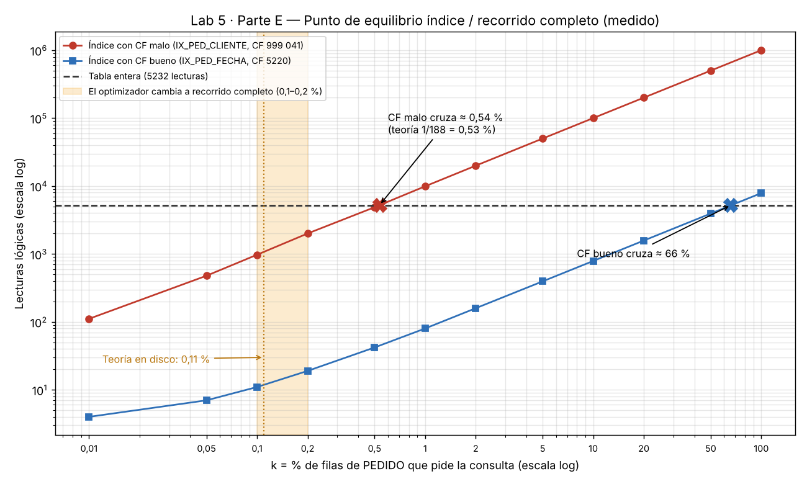

# Lab 5 · Oracle DBA Workflow II: respuestas

Issue #9 · rama `chore/9-oracle-dba-workflow-ii` · evidencias en `docs/bitacora/lab5/evidencia/`

## Parte A: punto de partida

- La copia `lab4-final` ocupa 795 MB comprimida (el volumen tiene 6101 MB) y las sumas SHA-256 dan OK.
- En el paso 6 del backup sale «ninguno: el volumen contiene toda la base de datos». En la copia del Lab 3 había cinco datafiles fuera, así que esto demuestra que la reubicación del Lab 4 funcionó.

## Parte B: banco TiendaSur

- CLIENTE: 100 000 filas, 1517 bloques, R = 102 bytes, bfr = 66 (el enunciado da 1467 y 98: mis filas son 4 bytes más largas). Con la fórmula, ⌈100 000 / 66⌉ = 1516, así que cuadra.
- PEDIDO: 1 000 000 filas, 5320 bloques, bfr = 188, igual que el enunciado.
- Más allá del enunciado: la base tiene FORCE_LOGGING = YES, así que el `INSERT /*+ APPEND */` generó todo el redo: los archivados pasaron de 1168 a 1364 MB (+196 MB) en 9,5 s.
- **B1 → B.** Si el optimizador espera 25 000 filas y salen 20, es que no hay histograma: sin él supone 1/4 = 25 % por estado.
- **Reto B.** Con `ROWID_BLOCK_NUMBER(ROWID, 'BIGFILE')` salen 5220 bloques con filas (mín. 2, media 191,6, máx. 200), frente a 5320 en las estadísticas. Los 100 que faltan son la cabecera, los bitmaps de ASSM y bloques bajo la HWM sin filas. Casi todos tienen 191-192 filas. No todos tienen las mismas porque la fila es de longitud variable (`importe`, `codigo_postal`) y el último bloque se quedó con 2.

## Parte C: anatomía de un índice

- IX_PED_CLIENTE: altura 3, 2216 hojas, fo real 370 y fo máximo 543, hojas al 90 %. Buscar por PK cuesta 4 lecturas (3 de índice + 1 de tabla) y 3 si es cubriente.
- En el volcado de la hoja de PK_CLIENTE, `row#0` tiene `data:(6): 00 00 03 1b 00 00` y la clave `c1 02`: es el bloque 0x31B = 795, ranura 0, el cliente 1. Son 6 bytes porque en BIGFILE no hace falta guardar el número de archivo.
- Más allá: las PK están llenas al 99,9 % y los índices creados con `CREATE INDEX`, al 90 %. Las PK se rellenan durante la carga con claves crecientes, mientras que CREATE INDEX respeta PCTFREE 10.
- Trampa que me encontré: `SET SERVEROUTPUT ON` hay que ponerlo después de `ALTER SESSION SET CONTAINER`, porque al cambiar de contenedor se pierde y el PL/SQL no muestra nada.
- **C1 → C (4).** BLEVEL 2 es altura 3, más 1 lectura de la tabla.
- **C2 → C (4).** 500² = 250 000 < 2 000 000, así que hacen falta 3 niveles de ramas más el de hojas.
- **Reto C.** Calculé altura 2 (30 B/entrada → 417 hojas, fo 543) y salió 3. Las entradas reales ocupan 35,9 B (501 hojas) y, al ser texto, la rama tiene 18,2 B por entrada, así que el fo baja a 441 < 501. PK_CLIENTE tiene fo 736 y altura 2. La altura depende también del tamaño de la clave. El mapa de PK_CLIENTE sale lleno (#) porque se cargó en orden; el de UX_CLI_EMAIL, al 90 % (=), porque se creó después.

## Parte D: tipos de índice

- Único 1486 → 3 (con ORA-00001 y ORA-03301); compuesto con SKIP SCAN 144 frente a 105; Q7 15 + SORT → 7 → 3 cubriente; funcional 1486 → 4; parcial 246 frente a 239, pero 54 hojas frente a 2933; bitmap 4073 → 528 (114 hojas frente a 1954); IOT 3 y hash 1, aunque la limpieza en hash lee 2770.
- **D1 → B.** **D2 → A y C** (el cubriente de Q7 ocupa 40 MB y la tabla 41,6 MB).
- **Reto D.** No haría cubriente IX_PED_FECHA para Q9: hoy cuesta 5 lecturas (3 de índice + 2 bloques de tabla) y como mucho ahorraría 2, a cambio de pasar de 22 MB a unos 42 MB (la tabla entera duplicada) y de encarecer cada INSERT.

## Parte E: factor de agrupamiento y punto de equilibrio

- CF de IX_PED_FECHA = 5220 (bloques con filas) y de IX_PED_CLIENTE = 999 041 (casi las filas). El cálculo a mano con LAG da lo mismo.
- **E1 → B.** Un CF malo con el 3 % es recorrido completo. Reconstruir el índice no cambia el CF, porque el CF depende de cómo está ordenada la tabla.
- **Reto E.** El índice con CF malo supera a la tabla en un ≈ 0,54 % (teoría 1/bfr = 0,53 %) porque visita un bloque por fila. El optimizador cambia antes, entre el 0,1 % y el 0,2 % (teoría 0,11 %), porque supone que la lectura aleatoria cuesta unas 5 veces más que la secuencial. El índice con CF bueno aguanta hasta un ≈ 66 % porque lee bloques consecutivos, y solo pierde porque además lee el propio índice (7875 frente a 5232 al 100 %).



## Parte F: sargabilidad

- Rota frente a reescrita: UPPER(email) 1486 → 4; fecha + 30 5285 → 321; cp = 30001 5232 → 106 (`filter(TO_NUMBER("CODIGO_POSTAL")=30001)`); OR 1486 → 6.
- Más allá: para `LIKE 'Gonz%'` el optimizador elige el índice y lee 2024 bloques, más que la tabla (1486). APELLIDOS no tiene histograma, así que no sabe que es un 2,1 % con CF malo.
- **F1 → B.** **F2 → A y C.**
- **Reto F: mi comentario de revisión en el PR**

  **issue (blocking):** `UPPER(apellidos) = 'GIL'` devuelve 0 filas de 100 000, porque `apellidos` guarda los dos apellidos (`'García Gil'`). Las 981 filas vienen todas del teléfono. ¿Querías los de segundo apellido Gil? Son 6121.

  **issue (blocking):** rompe la regla 1 (función sobre la columna en las dos ramas) y, por eso, la 5 (un OR solo usa índices si cada rama tiene el suyo). Medido: 1487 lecturas, y siguen siendo 1487 aunque cree índices en `telefono` y `apellidos`.

  **suggestion:** `WHERE telefono LIKE '600%' OR apellidos = 'Gil'` devuelve las mismas 981 filas en 722 lecturas (la mitad) con BITMAP OR. Pero esos dos índices no existen, así que habría que pasarlos antes por el protocolo de la Parte G.

  **note:** si es el segundo apellido (`LIKE '% Gil'`), son 7033 filas (7 %): el recorrido completo (1499) es el plan correcto. Para buscar bien por apellido habría que separar `apellido1` y `apellido2`.

## Parte G: protocolo de diseño de índices y V005

- Bloques modificados por fila (INSERT / UPDATE estado / UPDATE importe / DELETE): hoy, con 4 índices, 10,1 / 2 / 6 / 10,1; con la propuesta del compañero (9), 20,4 / 6 / 6 / 20,1; con V005 (5), 12,1 / 8,1 / 6 / 10,1. Se cumple INSERT ≈ 2 + 2 × índices (dato + undo, y hoja + undo por cada índice).
- El redo por INSERT pasa de 1323 B a 2669 B con la propuesta del compañero: el doble de redo, que acaba archivado.
- Protocolo: MONITORING USAGE marca sin uso IX_PED_CANAL, IX_PED_CLIENTE, IX_PED_FEC_CLI e IX_PED_IMPORTE. Estado y canal no son viables para igualdad. IX_PED_CLIENTE es prefijo de IX_PED_CLI_FEC. IX_PED_IMPORTE pasa a INVISIBLE y Q2 sigue en 328 lecturas.
- Más allá: la pregunta 2 marca IX_PED_ESTADO como «no viable» (25 % de media), pero Q12 lo usa con 147 lecturas, porque 'P' es el 2 % y esas filas están juntas al final de la tabla. Con datos sesgados la selectividad media engaña. Aun así, el índice parcial de V005 es mejor: 54 hojas frente a unas 2900 que habría que mantener en cada UPDATE de estado.
- V005 borra IX_PED_CLIENTE después de crear el cubriente, que también empieza por id_cliente. Si no, la clave ajena se quedaría sin índice y cada DELETE de un cliente bloquearía PEDIDO entera.
- **G1 → B** (INVISIBLE). **G2 → B** (unos 1000: 2 bloques × 500 INSERT/s).
- **Reto G: mi índice, IX_CLI_TELEFONO para Q5 (identificar a quien llama por email o teléfono).** Lo creé, lo medí y lo borré; la decisión va como V006 en la rama `feat/9-v006-ix-cli-telefono`, sin fusionar. (1) Necesidad: Q5 pasa de 1486 a 6 lecturas con BITMAP OR. (2) Viabilidad: 99 952 valores distintos, 0,001 % por valor. (3) Escritura: el INSERT en CLIENTE pasa de 10,2 a 12,2 bloques por fila (+2, como dice la fórmula) y de 1392 a 1627 B de redo. Las altas de clientes son mucho menos frecuentes que los pedidos, así que el coste es pequeño. (4) Redundancia: ningún índice de CLIENTE empieza por telefono. (5) Ciclo de vida: 3 MB, se crea ONLINE y se vigila con DBA_INDEX_USAGE; si no se usa, INVISIBLE y fuera. Mi conclusión es que sí compensa.

## Parte H: divisiones de hoja, patrón cola y remedios

- 200 000 inserciones: AZAR 595 divisiones (0 de 90/10), 596 hojas al 75,4 %; CRECIENTE 398 divisiones, todas 90/10, 399 hojas al 99,9 %; REVERSE 511 (0 de 90/10), 512 hojas al 77,9 %. Con claves al azar sale un 75 %, del orden del 69 % (ln 2) de la teoría: un índice real de 200 000 entradas se acerca, pero no llega a coincidir.
- El precio de REVERSE: el rango `k BETWEEN 1000 AND 1100` cuesta 4 lecturas con el índice normal y 866 con REVERSE, porque ya no puede usar el índice y hace recorrido completo.
- Patrón cola: tras 200 000 altas, 150 000 bajas de las más antiguas y 50 000 altas, IX_COLA tiene 425 hojas, 224 de ellas vacías, y 70 497 entradas borradas (41 %). «El siguiente mensaje» cuesta 226 lecturas frente a 2 en un índice sano.
- Remedios: COALESCE deja 201 hojas y 2 lecturas, pero mantiene 4 MB; SHRINK SPACE baja a 1,69 MB; REBUILD ONLINE deja 223 hojas (más que COALESCE, porque vuelve a aplicar PCTFREE 10, con hojas al 89,7 %).
- Más allá: los archivados han pasado de 1364 a 2928 MB desde la Parte B, y esta Parte sola ha añadido 586 MB en 18 s. Están en `dbs` sin FRA y sin límite, así que hay que resolverlo en la Parte L.
- **H1 → B** (COALESCE: en línea y barato). **H2 → A y C.**
- **Reto H:** pendiente de clase (el índice degradado lo crea el profesor; el diagnóstico irá como comentario en el Issue #9).
- **Punto de control, con mis cifras:** (1) buscar por PK cuesta 4 lecturas = altura 3 del índice + 1 bloque de tabla (Parte C). (2) IX_PED_CLIENTE pierde frente a la tabla al 1 % porque, con un CF de 999 041, cada fila es un bloque: 9920 lecturas frente a 5232 (Parte E). (3) Q3 no usaba el índice porque Oracle añadía `TO_NUMBER("CODIGO_POSTAL")`: 5232 lecturas, y 106 con '30001' (Parte F). (4) Cada índice suma unos 2 bloques por INSERT: 10,1 con 4 índices y 20,4 con 9 (Parte G). (5) La cola leía 226 bloques para 1 fila porque recorría 224 hojas vacías por la izquierda (Parte H).

## Parte I: SCN y checkpoints

- El SCN sube aunque nadie haga nada: 5 646 623 y 5 646 625 con 3 s de diferencia (procesos internos, MMON, jobs).
- Antes del checkpoint, academia01.dbf (CON_ID 3) tenía 5 643 405 y system01.dbf (raíz) 5 643 252. No fue por una operación de tablespace: el backup acababa de reiniciar la base y FREEPDB1 se abrió un poco después que la raíz, con su propio checkpoint. Tras `ALTER SYSTEM CHECKPOINT`, control file y cabeceras quedan en 5 646 633.
- **Punto de control.** (1) PDB$SEED (CON_ID 2) se queda en 2 098 101 porque está en solo lectura: nadie cambia sus bloques y el checkpoint no la toca. (2) Mi ACTUAL_REDO_BLKS es 309, no 33 024, porque el SHUTDOWN IMMEDIATE del backup hizo un checkpoint completo y el redo de las Partes B a H ya estaba cubierto. (3) Con una carga diez veces mayor crecería el redo pendiente y con él el MTTR; lo acota FAST_START_MTTR_TARGET (más bajo = checkpoints incrementales más frecuentes = más escritura en datafiles).
- **I1 → B.**
- **Reto I.** Tras el UPDATE de 20 000 filas sin checkpoint: ACTUAL_REDO_BLKS pasa de 12 a 3676 (unos 1,8 MB de redo) y RECOVERY_ESTIMATED_IOS de 11 a 354 (bloques sucios). El MTTR se queda en 2 s y a los 30 s no baja, porque con fast_start_mttr_target = 0 DBWn solo escribe cuando el redo pendiente se acerca a TARGET_REDO_BLKS (663 552 bloques, unos 324 MB). La relación: cuanto más redo pendiente y más bloques sucios, más redo hay que aplicar y más bloques leer en una recuperación de instancia, y por tanto más MTTR.

## Parte J: control files

- Antes había 2 copias (control01 y control02, de 18 MB). Ahora hay 3: control03.ctl se añadió con el procedimiento oficial (`control_files` en el SPFILE porque es estático, SHUTDOWN IMMEDIATE, `cp -p` de una copia sana y STARTUP).
- En el control file: 26 datafiles, 17 de 28 registros de ARCHIVED LOG y 6 BACKUP SET que no hice yo (seguramente de cuando se construyó la imagen). Cuando se llena, reutiliza los registros que superan control_file_record_keep_time = 7 días; para un historial largo hace falta un catálogo de RMAN.
- El `BACKUP CONTROLFILE TO TRACE` genera un `CREATE CONTROLFILE ... NORESETLOGS FORCE LOGGING ARCHIVELOG` con todos los datafiles y redo logs: es la última defensa si se pierden las tres copias.
- Más allá: generé un PFILE nuevo desde el SPFILE y lo comparé con el del Lab 4 (`initFREE_lab4.ora`). Solo cambia la línea `*.control_files`. Así cualquier cambio de configuración física queda revisable con `git diff`.
- Las tres copias están en el mismo volumen: protegen de borrar o corromper UN archivo, no de perder el disco. En producción irían en discos distintos, con CONTROLFILE AUTOBACKUP de RMAN.
- **J1 → B.** **J2 → A y C.**

## Parte K: redo log

- Mi base no es la del enunciado: tiene 3 grupos de 200 MB, no 2 de 20 MB. Ahora cada grupo tiene 2 miembros (`redo0N.log` y `redo0Nb.log`). Los nuevos aparecen INVALID hasta que LGWR los escribe, y con los SWITCH LOGFILE el CURRENT avanza en círculo (secuencias 18 → 19 → 20).
- Errores protegidos: ORA-01623 al borrar el grupo CURRENT y ORA-01609 al borrar un miembro del CURRENT.
- **Más allá: corregí el paso 4c antes de ejecutarlo.** El kit supone 2 grupos y prueba a borrar otro para que salte ORA-01567. Con mis 3 grupos el DROP dejaría 2 y Oracle lo permitiría, así que el script habría borrado un grupo de verdad. Lo cambié para que solo lo pruebe si hay exactamente 2 grupos (el cambio está en `scripts/lab5/10-redo.sql`, comentado).
- **K1 → C.**
- **Reto K: dimensionar el redo.** Redo archivado hoy por hora (UTC): 12h 196 MB (1 cambio), 16h 196 MB (1 cambio, la carga de TiendaSur), 18h 587 MB (3), 19h 808 MB (6, la Parte H más 2 SWITCH manuales). Con mis grupos de 200 MB la carga de TiendaSur solo produjo 1 cambio, no decenas como en el enunciado con 20 MB. El pico es de 808 MB/h, así que para un máximo de 4 cambios por hora harían falta 808 / 4 = 203 MB: propongo 256 MB por grupo. Comandos (no ejecutados), con la base abierta:

  ```sql
  ALTER DATABASE ADD LOGFILE GROUP 4 ('/opt/oracle/oradata/FREE/redo04.log', '/opt/oracle/oradata/FREE/redo04b.log') SIZE 256M;
  ALTER DATABASE ADD LOGFILE GROUP 5 ('/opt/oracle/oradata/FREE/redo05.log', '/opt/oracle/oradata/FREE/redo05b.log') SIZE 256M;
  ALTER DATABASE ADD LOGFILE GROUP 6 ('/opt/oracle/oradata/FREE/redo06.log', '/opt/oracle/oradata/FREE/redo06b.log') SIZE 256M;
  -- Repetir hasta que los grupos 1-3 estén INACTIVE y ARCHIVED = YES en v$log:
  ALTER SYSTEM SWITCH LOGFILE;
  ALTER SYSTEM CHECKPOINT;
  ALTER DATABASE DROP LOGFILE GROUP 1;
  ALTER DATABASE DROP LOGFILE GROUP 2;
  ALTER DATABASE DROP LOGFILE GROUP 3;
  -- Sin OMF, Oracle no borra los archivos: se quitan después desde el sistema operativo (redo01*.log, redo02*.log, redo03*.log)
  ```

  Un grupo no se puede redimensionar: se crean los nuevos y se borran los viejos cuando ya no están ACTIVE ni CURRENT.

## Parte L: ARCHIVELOG y Fast Recovery Area

- Mi base ya estaba en ARCHIVELOG desde el Lab 3, pero sin FRA: archivaba en `?/dbs/arch` sin límite (casi 3 GB después de las Partes B a H). Antes de activar la FRA comprobé que ningún `log_archive_dest_n` tenía ruta; si lo hubiera tenido, los archivados seguirían yendo allí aunque hubiera FRA.
- El script provoca ORA-02097 + ORA-19802 al fijar la ruta antes que el tamaño. En el orden correcto (4 GB y luego `/opt/oracle/oradata/fra`) no hizo falta reiniciar, porque ya estaba en ARCHIVELOG. El destino pasa a USE_DB_RECOVERY_FILE_DEST.
- El corte se ve en v$archived_log: las secuencias 18 y 19 son `arch1_N_1237845575.dbf` en `dbs` y la 20 y 21 ya son OMF (`o1_mf_1_20_...arc`) en `fra/FREE/archivelog/2026_11_23/`.
- **Más allá: limpieza de los archivados antiguos con RMAN.** Con `DELETE NOPROMPT ARCHIVELOG LIKE '%/dbs/arch%'` borré 19 archivados (desde la secuencia 1, del 5 de julio, hasta la 19) y `dbs` bajó a 127 MB. Ninguna recuperación del laboratorio los necesitaba: el simulacro D hace su propia copia RMAN, y las copias en frío lab4-final y lab5-indices ya los contienen. Lo hice con RMAN y no con `rm` para que se actualice el control file.
- **Punto de control.** En mi caso ARC0-ARC3 ya aparecían en el Lab 4 (Parte H, 4 ARCn), porque la base ya estaba en ARCHIVELOG; lo único nuevo es el destino. Los nombres o1_mf_ son OMF: Oracle los crea en `fra/FREE/archivelog/<fecha>/`.
- FRA llena (2 MB, solo en memoria): ORA-16038 (no se puede archivar la secuencia 22), ORA-19809 y, en el alert log, ORA-19815 al 100 %. Los grupos 1 y 2 quedan con ARC = NO; si siguiera así, LGWR se pararía en «log file switch (archiving needed)». Al volver a 4 GB, ARCn reintenta solo y los dos pasan a YES. Como el cambio fue con SCOPE = MEMORY, el SPFILE sigue con 4 GB.
- **L1 → B.** **L2 → A y C** (E es la trampa: borrar con `rm`).

## Parte M: undo, lectura consistente y redo

- Comprobé antes que el estudiante 101 estaba ACTIVO (17 600 ACTIVO, 2000 EGRESADO, 400 INACTIVO); si ya hubiera sido EGRESADO, el experimento no habría mostrado nada.
- Dos sesiones: mientras A tiene el UPDATE sin confirmar, B ve ACTIVO. A tiene 1 bloque y 1 registro de undo en el segmento 5, TM modo 3 sobre ACA_ESTUDIANTES y TX modo 6. El `FOR UPDATE WAIT 3` de B da ORA-00054 + ORA-40097 «transaction ID 5.9.894» (segmento de undo 5, slot 9, secuencia 894); el 327 689 del mensaje es lo mismo codificado: 5 × 65 536 + 9. Tras el COMMIT, EGRESADO; el flashback de hace 40 s devuelve ACTIVO y con él se repara la fila. undo_retention = 900 y 0 errores ORA-01555.
- **Punto de control.** (1) B ve ACTIVO porque Oracle reconstruye una versión consistente del bloque aplicando el undo de A: lee la versión confirmada, no la del buffer cache. (2) B puede leer pero no bloquear: los lectores no bloquean a los escritores ni al revés, pero dos escritores sobre la misma fila sí, por el TX de A guardado en la ITL del bloque. (3) El flashback funciona porque el valor anterior sigue en el undo; hasta dónde se puede mirar atrás lo marca UNDO_RETENTION (900 s), que es un objetivo salvo con RETENTION GUARANTEE.
- Undo y redo de 10 000 filas: INSERT 1136 KB de undo y 4824 KB de redo (2031 de ellos describen el undo), con un ROLLBACK de 355 KB; UPDATE de canal 568 / 1258 (540), ROLLBACK 751; DELETE 3416 / 6626 (3262), ROLLBACK 4701. El DELETE guarda la fila entera y sus entradas de índice, y deshacerlo genera casi tanto redo como hacerlo.
- **M1 → C.** **M2 → C.** **M3 → B y D.**
- **Reto M.** Archivé antes para partir con el redo online vacío, repetí 12-undo-y-redo y volví a archivar: la FRA pasó de 46,1 a 63,8 MB (+17,7 MB, el tamaño exacto del archivado de la secuencia 25). El redo que midió mi sesión fue de 17,2 MB. La diferencia de 0,5 MB es el redo del resto de la instancia en ese intervalo (procesos de fondo, COMMIT y ROLLBACK, cabecera del archivado), que v$mystat no ve. Más allá: el INSERT generó 3895 KB en vez de 4824, porque los bloques ya estaban calientes de la primera ejecución.

## Parte N: LGWR, DBWn y write-ahead logging

- UPDATE de 20 000 filas + COMMIT: 1779 KB de redo en 2 escrituras de LGWR, 0 bloques escritos por DBWn y 231 bloques de la tabla sucios en memoria. ALTER SYSTEM CHECKPOINT: 8 KB de redo, 348 bloques escritos por DBWn y 0 bloques sucios.
- **Punto de control.** (1) Tras el COMMIT no hay ni un bloque de la tabla escrito en el datafile (DBWn = 0, sucios = 231). La garantía está en el redo: el COMMIT termina cuando LGWR ha escrito el redo en el redo log online (log file sync); si la instancia cae, la recuperación rehace los bloques con ese redo. (2) DBWn escribe 348 bloques y no 231 porque también escribe los bloques de undo que ensució el UPDATE, más cabeceras y bloques de otras sesiones: las cifras son de toda la instancia. (3) Un UPDATE que no cambia nada genera redo porque Oracle no compara valores antes de escribir: cada fila genera su cambio en el bloque, su undo y el redo de ambos.
- **Más allá: por qué mi redo es 4 veces menor que el del enunciado (1779 frente a 7685 KB).** En el Lab 4 (Parte K) vi en el volcado del bloque que la ITL tenía Lck 90: la transacción de V002 estaba confirmada pero sin limpiar. El primer UPDATE masivo tras una carga hace esa limpieza diferida y genera redo extra, que es lo que midió el enunciado. En mi tabla ya la habían hecho los UPDATE de las Partes I, L y M, y queda el redo puro del cambio: 1,8 MB, la misma cifra que en el reto I (3664 bloques de redo).
- **N1 → A.** **N2 → B y C.**
